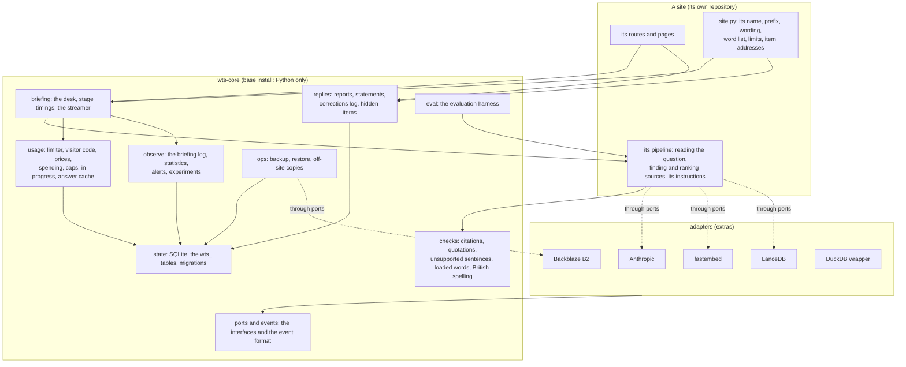

# Architecture

The design of wts-core, how its parts fit together and the main decisions behind it, for a developer or
maintainer who wants the whole picture before reading the code.

wts-core is the shared foundation of the Where They Stand sites. It holds everything the sites do alike:
settings, the state database, limits and caps, cost, the checks on briefings, the flow of a briefing from question
to last word, reports and the right of reply, backup, and a record of how each briefing went, with statistics,
alerts and an evaluation harness. Each site keeps what follows from its own record: finding and ranking sources,
its instructions to the model, its pages and its wording.

The decisions are recorded in twelve short ADRs in [`adr/`](adr/), each with the alternatives considered.

## Main decisions

| # | Decision | Reason | Record |
|---|---|---|---|
| 1 | The package runs the whole flow of a briefing (rate limit, cache, caps, writing, recording), and each site keeps its route, pipeline and wording | Every briefing gets the same record and timings without four hand-written copies of the flow | [0009](adr/0009-briefing-desk.md) |
| 2 | The package's tables sit beside each site's own in the same state database, with names starting `wts_`. Each site copies its rows across once | A deploy can be undone: the previous version still finds its tables as it left them | [0005](adr/0005-state-database.md) |
| 3 | Sites install a wheel from a tagged GitHub release | Three of the four Docker images have no `git`, so a git dependency would not install. No token is needed | [0006](adr/0006-distribution.md) |
| 4 | Each briefing's timings, cost, check results and outcome are kept for 13 months, with nothing about the reader. Failed briefings' questions are blanked after 90 days | The sites can be measured and improved without collecting anything new about readers | [0012](adr/0012-briefing-record-and-statistics.md) |
| 5 | The rules of the right of reply are in the package; pages, addresses and wording stay with each site. Any item can be hidden with a note while a concern is decided | Named people meet the same rules on every site | [0008](adr/0008-reports-and-statements.md) |
| 6 | One read-only check token for the family, so the nightly check can ask each site what is waiting and ask a real question that skips the cache | The nightly check can test what readers use, and the token can read or change nothing else | [0010](adr/0010-ci-and-nightly-check.md) |
| 7 | The checks on briefings are in the base install, and the `ai` extra holds only the model, embedder and index adapters | The checks need no AI library. Modules are grouped by what they import | [0001](adr/0001-slices-and-module-boundaries.md) |
| 8 | Fixes were ported to every site's copy of the engine first; structure converged once, when each site adopted the package | Less risk on the live sites, and no work done twice | [0011](adr/0011-phases-and-convergence.md) |

The other four records cover the interfaces for swappable parts ([0002](adr/0002-ports-and-adapters.md)), the
event format ([0003](adr/0003-event-format.md)), how a site plugs in its own parts
([0004](adr/0004-how-sites-plug-in.md)) and versioning ([0007](adr/0007-versioning.md)).

## Goals

- Changing the AI model is a setting; changing the provider, embedder, index or off-site store is one adapter.
- A new site copies no package code.
- Speed, cost and accuracy are measured from the first day.
- Every site is built and checked the same way.
- Readers see no change from a site's move onto the package unless it is listed, and the checks on briefings
  never get weaker.

## The shape

There are three layers. A site owns what a reader sees and everything that follows from its record. The base of
the package owns the rules every site shares and imports nothing but the standard library. The adapters are the
only code that touches an outside tool, each behind an interface in `ports`, and each can be replaced by writing
one module that passes its contract tests.

Two boundaries are enforced by tests (`tests/test_walls.py`): nothing outside `adapters/` may import an outside
library, and `replies` shares no import with anything that touches the model, the index or the record of
briefings.

## A briefing, from question to last word

1. The site's route receives the question, works out the visitor's code (`usage.visitor_code`: an IPv6 visitor
   by their /64, with a salt that changes daily) and builds an `Ask`: the question, the code, the site's own parts
   of the cache key, and two functions of its own, `write()` and `sources_only(note)`.
2. `BriefingDesk.handle(ask)` applies the rate limit, looks in the answer cache, checks the caps, reserves a place
   among the briefings in progress, checks the caps again with the others counted, and runs the site's pipeline.
3. The site's pipeline reads the question (`ModelClient.structured`), finds and ranks its sources with the shared
   `Embedder` and `VectorIndex`, sends the `sources` event and streams the briefing (`ModelClient.stream`).
4. When the model has finished, the pipeline passes the model's blocks and its sources to `checks`. Every
   citation is checked against the source text, uncited sentences are classed and flagged, quotations are checked
   word for word, loaded words outside quotations are marked, and American spellings in the model's own words are
   made British. The `final` event carries that report.
5. The desk records the cost, saves the briefing at its own address, caches the replay, and writes one row to the
   record of briefings: how it ended, how long each stage took and what the checks found.
6. The streamer sends each event to the reader as it happens. If the reader leaves, it stops the pipeline at the
   next event and closes the model's stream, so nothing more is written or paid for.

Steps 1 and 3 are the site's; steps 2, 4, 5 and 6 are the package's.

## The parts

- Modules and extras: [ADR 0001](adr/0001-slices-and-module-boundaries.md). Each module has one reason to
  change.
- Swappable parts: [ADR 0002](adr/0002-ports-and-adapters.md). The interfaces are in one file. A new model is a
  settings change; a new provider, embedding model, vector store or off-site store is one adapter and its contract
  tests. An unknown model stops the site at start-up, and a changed embedding model turns search by meaning off
  until the index is rebuilt. `adapters/skeleton_provider.py` is a template for a second provider
  ([`EXTENDING.md`](EXTENDING.md), section 7).
- The event format: [ADR 0003](adr/0003-event-format.md). Typed where the provider's events are translated, and
  plain JSON where events are stored and sent to readers.
- How a site plugs in: [ADR 0004](adr/0004-how-sites-plug-in.md). A `Settings` subclass, a `Site` and a
  `Messages` object, and a few small interfaces. No global state and no wording in the package.
- Storage: [ADR 0005](adr/0005-state-database.md).
- Reports and the right of reply: [ADR 0008](adr/0008-reports-and-statements.md).
- The public interface is what each module exports in `__all__`. It is recorded in
  [`api-snapshot.txt`](api-snapshot.txt) and checked by `tests/test_public_api.py`.

## Keeping each site's behaviour

1. What differs between sites on purpose is passed in. Every limit, message, word list, file name and pattern
   that is a site's own is a field of that site's `Site`, `Messages` or settings, and the package has no default
   for it.
2. What differed by accident takes the best version's behaviour, and the module's docstring says which.
3. Each site's behaviour was pinned before it was replaced. Golden outputs were recorded from the site's own code
   on fixed inputs (verifier reports, costs, cache keys, limiter and cap decisions and their wording, whole
   briefing streams byte for byte, rows written, backup names and contents), and the package had to reproduce
   them. The parity tests in this repository run against the sites' code when their checkouts are present.
4. Stored data keeps its meaning. Saved briefings, cached answers and spending were copied as they were, and the
   event format's first version is the format the sites already stored.

### Checking a saved briefing again

A saved briefing keeps its segments but not the blocks the model wrote, so judging it again can never repeat
exactly what the verifier did the first time. Every report is therefore stamped with the version of the checking
rules that wrote it (`rules`, an optional key the event format allows), and `Verifier.recheck` leaves alone any
answer written under the current rules. Only a briefing saved under older rules is judged again. A property test
asserts that rechecking anything the current verifier has just written changes nothing.

One rule differs between sites. Where MPs Stand and Where Countries Stand treat any sentence containing
"is/are/was/were (not) supplied/retrieved" as a note about the evidence (`EVIDENCE_NOTES_WIDE`), which clears some
ordinary claims. Where Councils Stand uses the strict form (`EVIDENCE_NOTES_STRICT`), at the cost of flagging some
genuine notes. The package offers both and has no default; moving a site from one to the other changes what is
flagged, so it is done as its own change with an evaluation run before and after.

## Measurement and evaluation

[ADR 0012](adr/0012-briefing-record-and-statistics.md) sets out the record of each briefing, the statistics, the
weekly report, alerts and experiments. [`IMPROVING.md`](IMPROVING.md) is the routine for using them.

The evaluation harness (`wts_core.eval`) has two halves:

- Replay, free and offline. A fixture is a recorded briefing: the question, the documents the model was given and
  the blocks it returned. The harness runs the checks over fixtures and compares the reports with the recorded
  ones. This is how a change to the verifier, the word lists or the spelling rules is measured before release,
  and how the package's CI guards against a check getting weaker. Fixtures are recorded by a site's evaluation
  run, never from readers' briefings.
- Live runs on the site's data. A site describes its question set through a small interface (load the questions,
  ask one under a configuration, say which group a source belongs to). The harness reports per question and
  overall: valid citations, grounded ratio, unsupported sentences, verified quotations, loaded words, judged
  answers where the set has them, the spread of sources by group, time to first word and to the full briefing,
  and cost. It compares two configurations, saves runs to the site's `eval/runs/`, and fails if any figure falls
  below the site's thresholds.

A configuration that has not passed a live run cannot be used in an experiment.

## Other design choices

- There is no generic `StateStore`. A small interface for each need is clearer about what a different database
  would have to provide.
- The model interface is defined by the family's needs and translated for each provider. A citation is defined
  as "this document, these words", and reading a question is a separate structured call.
- The `sources` event, sent before any text, is a rule of the event format and is timed.
- The nightly check's question skips the answer cache, or it would test nothing on most nights, and it is marked
  so that it does not count in the statistics.
- Alert thresholds start empty and are proposed from the first weekly report, so no guessed threshold raises
  false alarms or stays silent.
- A follow-up question is not linked to the earlier one. A yes or no on the earlier briefing gives the statistic;
  a link between two questions would be a stored trail of one reader's session.

## Build, release and CI

- Distribution: a wheel attached to a tagged release ([ADR 0006](adr/0006-distribution.md)).
- Versions and the public interface: [ADR 0007](adr/0007-versioning.md).
- CI and the nightly check: [ADR 0010](adr/0010-ci-and-nightly-check.md). Reusable workflows for jobs that are
  the same in every repository (`python.yml`, `web.yml`, `kit.yml`, `docker.yml`), shared steps in
  `.github/actions/`, and one toolchain written once in `toolchain.toml`.
- The example site (`examples/minimal-site/`) is a small FastAPI site that uses every part of the package. CI runs
  it end to end, and [`NEW-SITE.md`](NEW-SITE.md) is written by following it. There is no scaffolding command:
  copying the example is the recipe.

## Risks

| Risk | Mitigation |
|---|---|
| A change to the package changes what readers see, unnoticed | Golden transcripts of whole briefing streams in the parity tests; each site's own tests run against a new version before release |
| A check on briefings gets weaker | The union of the sites' verifier tests, replay fixtures in CI, fuzz tests comparing old and new behaviour, and each site's evaluation run |
| Live data is lost or misread in a migration | Migrations only add; a site's old tables stay until a stated date; a copy of the file is made before an import; imports are tested against databases built by each site's own code |
| The record of briefings collects more than the privacy notices say | Every field is checked against the notices (ADR 0012), and the privacy tests attempt the joins an attacker would make |
| A statement reaches the model, the index or the record | The import boundary test, a contract test with a marker word that every site runs, and each site's page tests (ADR 0008) |
| A provider or library change lands badly | Lowest and highest dependency versions in CI, recorded fixtures, and the scheduled evaluation run |
| A site falls behind or patches around the package | One version number per site for both the package and the shared workflows; the nightly check reports each site's version |
