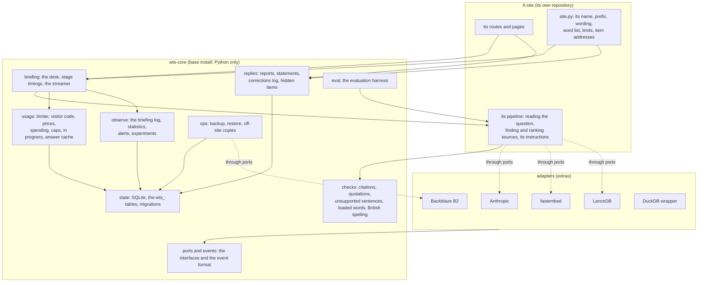

# wts-core: the design

13 November 2026. **Accepted by the owner on 13 November 2026,** with the privacy notice changes; the four questions on
the right of reply were left to the maintainer and are decided in record 0008. This page is the design of the shared
foundation for the Where They Stand sites. It rests on a line-by-line study of the four sites' copies
([`study/`](study/)) and is decided in twelve short records ([`adr/`](adr/)).

## For the owner: one page

**What is proposed.** One package, `wts-core`, that the four Python sites depend on. It holds everything the sites
do alike: settings, the state database, limits and caps, cost, the checks on briefings, the flow of a briefing from
question to last word, reports and the right of reply, backup, and (new) a record of how each briefing went, with
statistics, alerts and an evaluation harness. Each site keeps what follows its own record: finding and ranking
sources, its instructions to the model, its pages and its wording.

**Eight decisions to check first.** Each is a short record with the alternatives weighed.

| # | Decision | Why it matters to you | Record |
|---|---|---|---|
| 1 | **The package takes over the flow of a briefing** (rate limit, cache, caps, writing, recording), not just the parts. Each site's route, pipeline and wording stay its own | It is more than the brief lists. It is also the only way every briefing gets the same record and timings without four hand-written copies | [0009](adr/0009-briefing-desk.md) |
| 2 | **The package's tables sit beside each site's existing tables** in the same state database, with names starting `wts_`. Each site copies its rows across once; its old tables are left untouched for one release | Live data. If a deploy has to be undone, the previous version still finds its tables as it left them | [0005](adr/0005-state-database.md) |
| 3 | **Sites install a wheel from a tagged GitHub release,** not from a git tag | Three of the four Docker images have no `git`, so the brief's default would not build. No token is needed either way | [0006](adr/0006-distribution.md) |
| 4 | **What is kept about each briefing,** and for how long: timings, cost, what the checks found, how it ended. Nothing about the reader. 13 months [for you to confirm]; failed briefings' questions blanked after 90 days. **One sentence added to each privacy notice** | It goes slightly beyond what two notices describe today, so it needs your agreement before any site switches it on | [0012](adr/0012-briefing-record-and-statistics.md) |
| 5 | **The right of reply's rules move into the package; pages, addresses and wording stay with each site.** Five statuses (a statement the site removes is "removed"). Any item can be hidden with a note while a concern is decided | Named people meet these rules. Four open questions for you are at the end of the record | [0008](adr/0008-reports-and-statements.md) |
| 6 | **One read-only "check" token for the family,** so the nightly check can ask each site what is waiting and ask a real question without being served from the cache | One secret for you to make, set in two places. Until it is set, the new checks report "not set up" | [0010](adr/0010-ci-and-nightly-check.md) |
| 7 | **The checks on briefings are in the base install,** and the "AI" extra holds only the three adapters (Anthropic, fastembed, LanceDB) | The checks need no AI library. Slices follow what code imports, not its subject | [0001](adr/0001-slices-and-module-boundaries.md) |
| 8 | **Phase 1 ports fixes; it does not rewrite working code to look alike.** Structure converges once, when each site adopts the package | Less risk on the live sites, and no work done twice. The drift report will still show low numbers for some modules until adoption | [0011](adr/0011-phases-and-convergence.md) |

The other four records are the interfaces for things that may be swapped ([0002](adr/0002-ports-and-adapters.md)),
the event format ([0003](adr/0003-event-format.md)), how a site plugs in its own parts
([0004](adr/0004-how-sites-plug-in.md)) and versioning ([0007](adr/0007-versioning.md)).

**Found while studying the copies, and worth knowing now.** Each has a file and line in the studies.

| What | Where | What has been done |
|---|---|---|
| **A check weakens today.** When a saved or cached briefing is shown again, its flags are judged again without the block they were written in, and a real flag can be lost: a short sentence, a line above a lead-in, a sentence ending in a question mark. The study found the first; an independent review of the ports found the rest | all three AI sites | Fixed in each site's phase 1 pull request, with tests: in a fuzz of 150,000 briefings the recheck cleared a flag in 8,163 before and 17 after. The package closes the rest by design (MIGRATION 1.4) |
| **Where MPs Stand's `restore` can replace the live database with an empty one,** and is likely to fail part-way in the container. And on both sites that have a restore, a second one overwrote the only copy of the database the first replaced | MPs, Countries | Where Countries Stand's safer restore is ported to MPs in phase 1, and both now refuse to overwrite the kept copy |
| **Where Councils Stand's "Sources only" calls the model with no check of the spending caps;** its follow-up history is unbounded and saved with the briefing | Councils | Fixed in phase 1 |
| **A model refusal is saved as an empty briefing** with a perfect score | Countries, Councils | MPs' handling ported in phase 1 |
| **DuckDB 2 would have broken live requests on Where MPs Stand** after the library upgrade (one test caught one path) | MPs | Fixed in the upgrade pull request, in the shared connection wrapper |
| **One rule in the verifier is loose:** any sentence containing "was supplied" or "were retrieved" counts as a note about the evidence, not a claim ("Gas was supplied to two million homes" is not flagged) | MPs, Countries (Councils is strict) | **Not changed yet.** Narrowing it changes what is flagged on live briefings, so it should come with an evaluation run. Proposed for the package, measured at adoption |
| Three privacy notices say the confirming address is "kept while the statement is shown"; the code keeps it while the statement waits too | MPs, Councils, Landlords | **Not changed:** the notices are yours. The sentence is drafted in [`MIGRATION.md`](MIGRATION.md) |
| The API key given to the build session is refused by Anthropic, and the sites' data is not in the session | | No evaluation run or live briefing could be made. See "What could not be done" in [`PROGRESS.md`](PROGRESS.md) |

**Decided since.** The design, the sentence for the privacy notices and 13 months were accepted. Still needed from
the owner: a working API key in the environment's settings (for evaluation runs), and, when the nightly check is
extended, the check token (record 0010).

---

## 1. What the package is for

Five goals, from the brief: changing the AI engine is a setting or one adapter; a new site copies no code; speed
and accuracy are measured; the sites improve from how they are used; every site is built and checked the same
way. And one rule above them: **readers see no change** unless listed, and the checks on briefings never weaken.

The sites' behaviour today is the specification. The studies record it: every function, default, message, table
and file name, per site, with what differs and which copy is best. Where this design says "as today", it means as
those four documents say.

## 2. The shape

Read it as three layers. A **site** owns what a reader sees and everything that follows its record. The **base**
of the package owns the rules every site shares, and imports nothing but Python. The **adapters** are the only
code that touches an outside tool, each behind an interface in `ports`, each replaceable by writing one file and
passing one contract suite.

Two walls are tested, not just drawn: nothing outside `adapters/` may import an outside library, and `replies`
shares no import with anything that touches the model, the index or the record.

## 3. A briefing, from question to last word

1. The site's route receives the question, works out the visitor's code (`usage.visitor_code`: an IPv6 visitor by
   their /64, a salt that changes daily) and builds an `Ask`: the question, the code, the parts of the cache key
   that are the site's own, and two functions of its own, `write()` and `sources_only(note)`.
2. `BriefingDesk.handle(ask)` runs the flow every site has today, in today's order: rate limit; look in the answer
   cache; check the caps; reserve a place among the briefings in progress and check the caps again with the others
   counted; run the site's pipeline.
3. The site's pipeline reads the question (`ModelClient.structured`), finds and ranks its sources (its own code,
   with the shared `Embedder` and `VectorIndex` underneath), sends the `sources` event, and streams the briefing
   (`ModelClient.stream`), passing text to the reader as it arrives.
4. When the model has finished, the pipeline hands the model's blocks and its sources to `checks`: every citation
   is checked against the source text, uncited sentences are classed and flagged, quotations are checked word for
   word, loaded words outside quotations are marked, American spellings in the model's own words are made British.
   The `final` event carries that report.
5. The desk records the cost, saves the briefing at its own address, puts the replay in the cache, and writes one
   line to the briefing log: how it ended, how long each stage took, what the checks found.
6. The streamer sends each event to the reader as it happens. If the reader leaves, it stops the pipeline at the
   next event and closes the model's stream, so nothing more is written or paid for; the log line says "left" and
   at which stage.

Steps 1 and 3 are the site's. Steps 2, 4, 5 and 6 are the package's. Where MPs Stand, Where Countries Stand and
Where Councils Stand each have steps 2, 5 and 6 written out by hand today, alike but for a dozen differences
(`study/usage-state-stream.md`, section 3).

## 4. The parts

- **Modules and extras:** [ADR 0001](adr/0001-slices-and-module-boundaries.md). Fourteen modules, each with one
  reason to change.
- **What can be swapped, and how:** [ADR 0002](adr/0002-ports-and-adapters.md). Nine interfaces in one file. A new
  model is a settings change; a new provider, embedding model, vector store or off-site store is one adapter and
  its contract suite. An unknown model stops the site at start-up; a changed embedding model turns search by
  meaning off until the index is rebuilt.
- **The event format:** [ADR 0003](adr/0003-event-format.md). Typed where the provider changes; today's JSON,
  unchanged, where it is stored and sent to readers.
- **How a site plugs in:** [ADR 0004](adr/0004-how-sites-plug-in.md). A `Settings` subclass, a `Site` and a
  `Messages` object, a few small interfaces. No global state, no wording in the package.
- **Storage:** [ADR 0005](adr/0005-state-database.md).
- **Reports and the right of reply:** [ADR 0008](adr/0008-reports-and-statements.md).
- **The interface itself,** name by name: [`API-SKETCH.md`](API-SKETCH.md).

## 5. How every behaviour of today's copies is kept

Four rules, applied module by module in [`MIGRATION.md`](MIGRATION.md):

1. **What differs on purpose is passed in.** Every default, limit, message, word list, file name and pattern that
   the studies mark as a site's own becomes a field of that site's `Site`, `Messages` or settings. The package has
   no default for any of them.
2. **What differs by accident takes the best copy's behaviour,** and the difference is listed for that site in
   MIGRATION.md, with whether a reader, the owner or nobody would notice. The fixes among these are ported in
   phase 1, before the package exists, so an adoption is a change of structure only.
3. **Each site's behaviour is pinned before it is replaced.** Before a site switches, golden outputs are recorded
   from its current code on fixed inputs: the verifier's report on saved blocks, cost for recorded usage, cache
   keys, limiter and cap decisions and their wording, resolved settings, the bytes of whole briefing streams, the
   rows written to the state database, backup file names and contents. The package must reproduce them. The tests
   stay in the site.
4. **Stored data keeps its meaning.** Saved briefings, cached answers and spending are copied as they are; the
   event format's first version is today's.

The package's own tests are the union of the four sites' tests for these modules (the studies list them, with
the cases only one site covers), plus the contract suites.

## 6. Measured from the first day

[ADR 0012](adr/0012-briefing-record-and-statistics.md) sets out the record of each briefing, the statistics, the
weekly report, alerts and experiments.

**The evaluation harness** (`wts_core.eval`) deserves a note here, because the study changed its design. Today only
Where MPs Stand's evaluation runs the checks on briefings, and it needs that site's whole archive and a key. The
other two score how questions are read and whether evidence was found. And nothing anywhere keeps the model's raw
output, so the checks can't be re-run on yesterday's briefings without paying to write them again.

So the harness has two halves:

- **Replay, free and offline.** A fixture is a recorded briefing: the question, the documents the model was given,
  and the blocks it returned. The harness runs the checks over fixtures and compares the reports with the recorded
  ones. This is how a change to the verifier, the word lists or the spelling rules is measured before it ships,
  on any machine, and it is how the package's own CI guards "the checks never weaken". Fixtures are recorded by a
  site's evaluation run (never from readers' briefings), with personal details removed, and a small set ships
  with the package.
- **Live runs, on the site's data.** A site describes its question set to the harness through a small interface
  (load the questions; ask one under a configuration; say which group a source belongs to). The harness reports,
  per question and overall: citations valid, grounded ratio, unsupported sentences, quotes verified, loaded
  words, judged answers where the set has them; the spread of sources by group; time to first word and to the
  full briefing; cost. It compares two configurations side by side, saves to the site's `eval/runs/`, records
  fixtures for the replay half, and fails if any figure falls below the site's thresholds. Each site's existing
  questions and judgements are read as they are.

A run that passes writes a line the experiment guard reads (ADR 0012): a version that hasn't passed can't go live.

## 7. Building, releasing and checking

- **Distribution:** a wheel attached to a tagged release ([ADR 0006](adr/0006-distribution.md)).
- **Versions and the public interface:** [ADR 0007](adr/0007-versioning.md).
- **CI and the nightly check:** [ADR 0010](adr/0010-ci-and-nightly-check.md). Reusable workflows for jobs that are
  the same everywhere, shared steps where a site must start itself first, one toolchain written once.
- **The example site** (`examples/minimal-site/`): a small FastAPI site using everything (its own prefix and
  wording, limits and caps, a scripted model streaming a briefing through the checks and the desk, a statement
  beside an item, backup). CI runs it end to end, the contract tests run against it, and `docs/NEW-SITE.md` is
  written by following it. No scaffolding command: copying the example is the recipe, and one thing to keep in
  step is better than two.

## 8. Where this design departs from the brief, and why

The brief invited this. Each point is argued in the record named.

1. **The flow of a briefing belongs in the package** (0009). The brief shares the parts and leaves the flow in each
   site. But the per-briefing record, the stage timings and experiments all hang on the flow, and three
   hand-written copies of it is the drift this package exists to end.
2. **Slices by what code imports, not by subject** (0001). The checks need no AI library, and the streamer needs no
   web framework. Where Landlords Stand's rule is about dependencies, and this keeps it more simply.
3. **A wheel from a release, not a git tag** (0006). The default doesn't build in three images.
4. **No generic `StateStore`** (0002). A small interface per need is honest about what a different database would
   have to provide; a generic store over SQL is not.
5. **The model interface is the family's, not the provider's** (0002, 0003). Citations are defined as "this
   document, these words". Reading a question needs a second, structured call the brief's interface left out.
6. **"Sources ready" already exists** (0003): the `sources` event, sent before any text on all three sites. The
   package makes it a rule and times it; no new event.
7. **Converge by adopting, not before** (0011). Rewriting three sites' working backup or cache code to match a
   fourth, then deleting all four copies weeks later, pays for the risk twice.
8. **Old tables are kept for a release** (0005). The brief doesn't mention the live databases. They are the one
   thing that can't be rebuilt, and four sites have four shapes.
9. **The nightly question must skip the cache** (0010), or it tests nothing on six nights in seven; and it must be
   marked, or it pollutes the statistics it sits beside.
10. **Alert thresholds start empty** (0012). "Start the thresholds from the first baseline" is right, so the
    package proposes them from the first weekly report rather than shipping guesses that would cry wolf or stay
    silent.
11. **A follow-up is not linked to its earlier question** (0012). The brief asks for "what the reader did next"
    linked to the briefing's record. A yes or no on the earlier briefing gives the statistic; a link between the
    two questions would be a stored trail of one reader's session.
12. **ENGINE.md is out of date in five places,** which changes which copy each fix starts from: Where MPs Stand's
    verifier is now the fullest, not Where Countries Stand's; Where Councils Stand is the strict copy of one rule
    and must not take the others' looser one; the streamer is the same in all three; Where MPs Stand and Where
    Countries Stand, not Where Councils Stand, have the better cost code; Where Countries Stand has the only safe
    restore. It is corrected in the charity repository's phase 1 pull request.
13. **Not everything in the brief's phase 3 belongs in v0.1.0.** The brief puts timings, the harness, the record,
    logs, `stats` and alerts in the first release. That is right for the record and timings (adoption is measured
    from the first day). The live-experiment switch should wait for v0.2.0: no site may run one until its public
    wording is changed and a baseline exists, and shipping an unused switch in the first release adds risk for
    nothing. Its settings and the record's fields are in v0.1.0, so nothing has to change shape later.

## 9. Risks, and how each is caught

| Risk | Caught by |
|---|---|
| An adoption changes what readers see, and no test notices | Golden transcripts of whole briefing streams, byte for byte, recorded from the site's current code before the switch (0009); a second reviewer with fresh context reads each adoption's whole diff against this page |
| A check on briefings gets weaker in the move | The union of the three sites' verifier tests; replay fixtures in the package's CI; each site's evaluation run before and after adoption. One existing weakness was found by the study and is fixed first |
| Live data is lost or misread in the move to `wts_` tables | The old tables are untouched for a release; a copy of the file is made first; the import is tested against a database built by each site's current code (0005) |
| A spending cap resets at adoption | The month's spending rows are imported; a test asserts today's and the month's totals match |
| The visitor's daily limit resets at adoption | The day's counts are imported the same way. At worst a visitor gets one extra day's allowance, once |
| Three Docker builds can't fetch the package | Verified in a slim image with no `git` before any site adopts; the fallback is recorded (0006) |
| Where MPs Stand, the live site, breaks on adoption | It adopts last, after three smaller sites; its library upgrade is a separate pull request, already made; its flow has the most hooks, and they are proved elsewhere first |
| The package becomes a second place for drift (sites patch around it) | The drift check changes its job in phase 5: it fails a site that carries a copy of a package module or is more than one minor version behind |
| The per-briefing record collects more than the privacy notices say | Every field is checked against the notices (0012); the question arises at each site's adoption, with the owner's agreement, not in the package |
| A statement reaches the model, the index or the record | Three tests: the import wall, the contract test with a marker word every site runs, each site's page test (0008) |
| The owner's routine breaks (commands renamed, files renamed) | Backup file names, formats and retention are each site's own and unchanged; old command names work for a release; MIGRATION.md lists every command by site |
| An SDK or provider change lands badly | Lowest-and-highest version jobs in CI; recorded fixtures; the weekly scheduled evaluation run catches a model changing under the sites |
| One maintainer, four sites, one package: an upgrade is forgotten | One number per site to raise (package and CI at the same tag); the nightly check reports each site's version |
| The design is wrong somewhere that only building shows | v0.1.0 is built against the example site and Where Landlords Stand first; an ADR is amended, not ignored, when building disagrees with it |

## 10. From here

1. **Now, without waiting:** phase 1 (the ports, the library upgrade), 1b ("Why use this rather than a
   chatbot?") and 1c (one toolchain), as pull requests in each repository.
2. **After your review:** phase 3, the package, in the order of the modules above, the example site growing with
   it; `v0.1.0`.
3. **Then** phase 4, one site at a time: Where Landlords Stand, Where Councils Stand, Where Countries Stand, Where
   MPs Stand.
